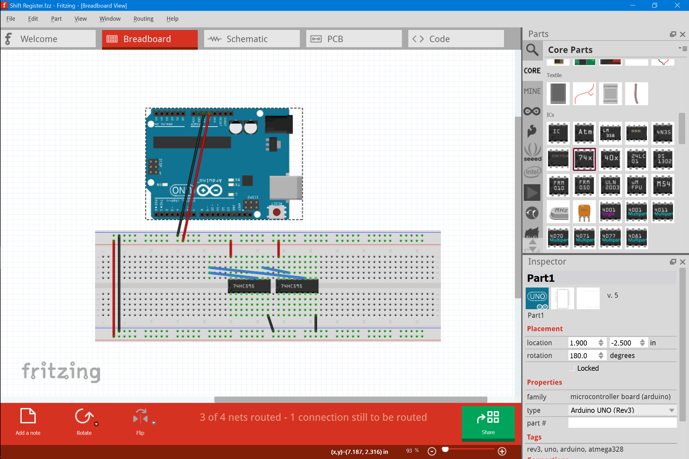
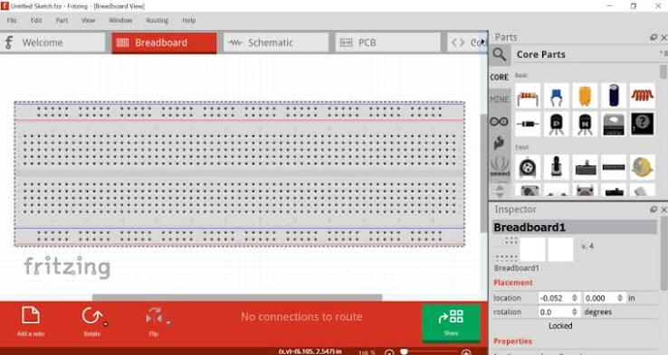

# Fritzing Circuits From Breadboard To Fabrication Files

A useful circuit drawing lets someone rebuild the prototype, understand its connections, and check the board before fabrication.
Fritzing Software brings those tasks into a project with breadboard, schematic, and PCB representations.

[](https://fritzing-software.github.io/Fritzing-Breadboard/)

## Read one circuit in three different ways

Start with a small working prototype and use each view to answer a different question.
Fritzing Breadboard drawings are particularly useful when connector positions and jumper placement matter.

| Review question | Breadboard view | Schematic view | PCB view |
| --- | --- | --- | --- |
| Where does this wire go physically? | Shows the parts and their connections | Explains the electrical relationship | Shows the corresponding routed connection |
| Which pins belong to the same signal? | Inspect highlighted connections | Follow the net through symbols | Compare the ratsnest and copper |
| Will the component fit? | Compare the pictured package | Check the symbol's pin assignment | Check the footprint and board placement |
| What should be shared? | Assembly illustration | Electrical explanation | Fabrication layout |

Switching views preserves the underlying circuit, but each representation still needs a readable arrangement.
A ratsnest line indicates a required connection; it is not a finished copper trace.
The official [circuit tutorial](https://fritzing.org/learning/tutorials/building-circuit/) demonstrates connector highlighting and moving between views.

The supplied [sketch.pri](pri/sketch.pri) lists the view implementations, while [model.pri](pri/model.pri) lists the shared model classes.
[connectors.pri](pri/connectors.pri) covers connector and bus classes, and [items.pri](pri/items.pri) lists drawable circuit items.

## Choose parts by their pins and footprint

A familiar-looking module can still have a different connector order from the hardware on your desk.
Check the exact board revision, connector labels, pitch, and package before trusting a library drawing.

- Match power and ground pins to the manufacturer's documentation.
- Check pin numbering from the correct viewing direction.
- Confirm that the PCB footprint matches the physical package.
- Use meaningful part labels so similar components are distinguishable.
- Recheck connections after replacing a part with another variant.



The parts palette is represented in [partsbinpalette.pri](pri/partsbinpalette.pri), the reference-library layer in [referencemodel.pri](pri/referencemodel.pri), and the Inspector-related classes in [infoview.pri](pri/infoview.pri).
For a custom part, the metadata and SVG graphics must agree on connector identifiers.

This Python example reads an existing, unpacked FZP file and prints its declared connector IDs and names:

```python
import xml.etree.ElementTree as ET

part = ET.parse("sensor-module.fzp").getroot()
print("Part:", part.findtext("title"))
for connector in part.findall("./connectors/connector"):
    print(connector.get("id"), connector.get("name"))
```

Use the output to compare connector declarations with your pinout notes and SVG element IDs.
It does not validate electrical behavior or establish that the footprint dimensions are correct.
The upstream [part-format reference](https://github.com/fritzing/fritzing-app/wiki/2.1-Part-file-format) explains how metadata refers to graphics.

## Make custom graphics readable at their actual size

Part artwork serves several purposes: a recognizable breadboard image, a clear schematic symbol, and an accurately scaled footprint.
Review each representation separately before sharing the part.

Check that text remains legible, terminals land on the intended points, and the exported artwork has the expected bounds.
The SVG subsystem is listed in [svg.pri](pri/svg.pri).

The supplied regression material separates several graphics concerns:

- Path parsing: [test_pathparse.cpp](tests/auto/test_svg/test_pathparse.cpp).
- Path tokenization: [test_pathlexer_public.cpp](tests/auto/test_svg/test_pathlexer_public.cpp).
- Path-data preprocessing: [test_pathlexer_protected.cpp](tests/auto/test_svg/test_pathlexer_protected.cpp).
- Text bounds: [test_svgtext.cpp](tests/auto/test_svg/test_svgtext.cpp).
- Initial move-command matching: [test_mfinder.cpp](tests/auto/test_svg/test_mfinder.cpp).

These tests document specific implementation cases; passing them would not replace checking an individual part against its datasheet.
Keep the original editable artwork with your custom part so corrections can be made later.

## Check electrical assumptions before routing

For a fritzing circuit diagram, distinguish a connected net from a circuit that behaves as intended.
Where suitable part models are available, simulation can help examine basic DC behavior.

For a separate ngspice comparison, this operating-point netlist describes a 5 V supply and two equal resistors:

```spice
Equal-resistor divider
V1 supply 0 DC 5
R1 supply midpoint 10000
R2 midpoint 0 10000
.OP
.END
```

The ideal midpoint voltage is 2.5 V before a load is attached.
Adding a load changes that result, so include the measurement or downstream circuit when the distinction matters.

The Fritzing simulator sources are listed in [simulation.pri](pri/simulation.pri).
[spicedetect.pri](pri/spicedetect.pri) locates ngspice for the build, and [test_ngspice_simulator.cpp](tests/auto/test_ngspice_simulator/test_ngspice_simulator.cpp) exercises the simulator interface.

A visible microcontroller part is not evidence that its firmware has been simulated.
Check the available model support for the components you actually use.

## Route the board around physical constraints

For fritzing pcb work, place connectors, mounting features, and large components before spending time on fine routing.
Leave room for cables, component bodies, soldering access, and the enclosure.

1. Set the board outline and intended layer arrangement.
2. Position parts to shorten important connections.
3. Route the required nets, using the ratsnest as a guide.
4. Review clearances and trace widths against the intended current and fabrication process.
5. Recheck the design after moving components or changing a footprint.



Automatic routing can help find paths, but it does not decide every mechanical or electrical requirement.
[autoroute.pri](pri/autoroute.pri) lists routing and checking classes.
The official [PCB tutorial](https://fritzing.org/learning/tutorials/designing-pcb/) explains placement, manual routing, and export choices.

## Hand over a reviewed set of outputs

Save the editable project separately from the images or fabrication outputs you send to another person.
Use a breadboard illustration for assembly, a schematic for electrical review, and Gerber output for the board manufacturer.

On a Linux installation with the Fritzing executable available, this command exports projects in a prepared directory:

```bash
Fritzing --gerber "./fabrication-batch"
```

Place the intended FZZ or FZ files in that directory first; the export service writes generated files into the same directory.
The [upstream command handling](https://github.com/fritzing/fritzing-app/blob/develop/src/fapplication.cpp) implements the Gerber service.
Use an installed application with its parts library available and an appropriate Qt display environment.

Gerber conversion has a whitespace regression case in [test_svg2gerber.cpp](tests/auto/test_svg2gerber/test_svg2gerber.cpp).
[tests.pro](tests/tests.pro) defines the test subproject, and [test_project_properties.cpp](tests/auto/test_project_properties/test_project_properties.cpp) tests XML handling for project-specific settings.

Before ordering, inspect the exported layers and drill information in a suitable viewer.
Check the board outline, hole positions, copper clearances, and readable silkscreen.
Record the project revision that produced the output so a later edit cannot be confused with the reviewed version.

Fritzing open source materials include [org.fritzing.Fritzing.appdata.xml](org.fritzing.Fritzing.appdata.xml), which describes the application for desktop software catalogs.

## Related Search Terms

Fritzing Software, Fritzing Breadboard, Fritzing open source, fritzing pcb, fritzing circuit diagram, fritzing-application, eda, electronics, pcb, schematic, prototyping, breadboard, circuit-design, qt, hardware
